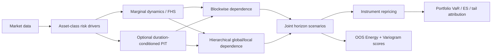
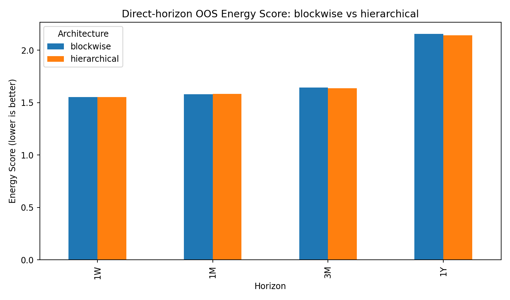
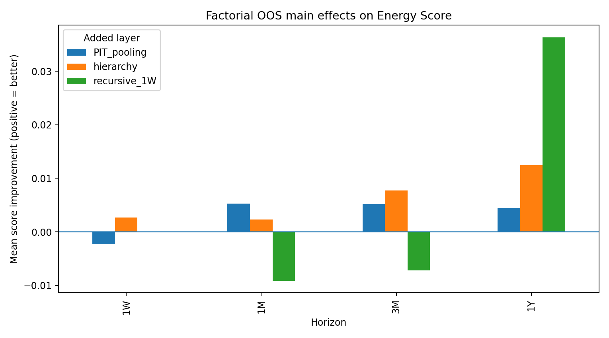
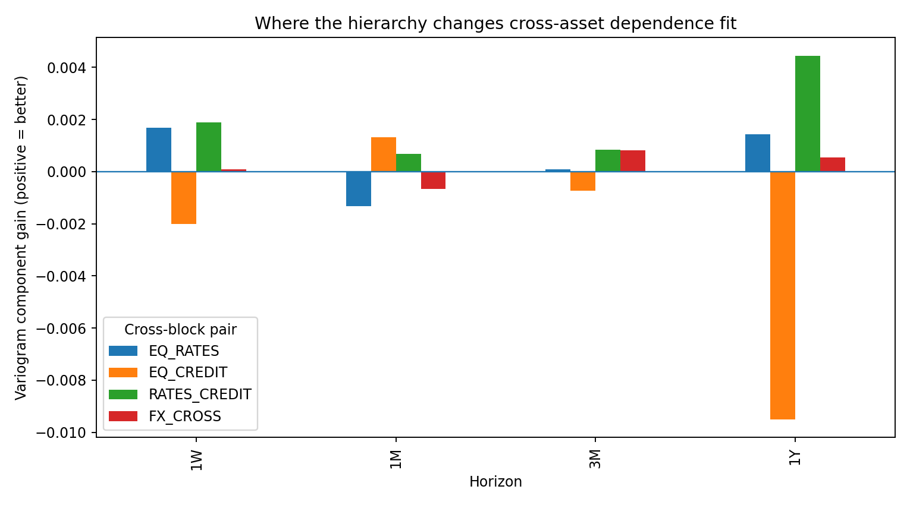
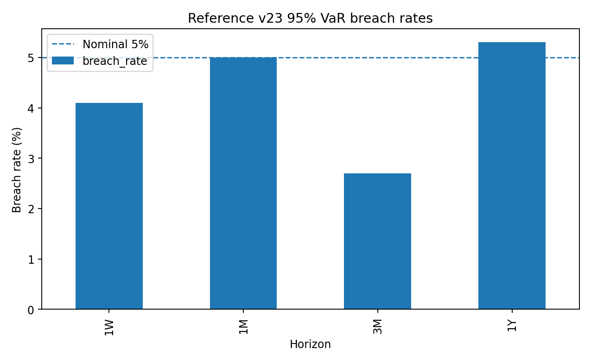

# Multi-Asset Scenario Engine

**Physical-measure scenario generation, adaptive cross-asset dependence, horizon repricing, and portfolio tail-risk analytics.**

This repository jointly models and reprices **US equities, Treasury rates, credit spreads and FX** over
1W / 1M / 3M / 1Y horizons. It combines asset-class factor models, filtered historical simulation,
empirical block resampling, full instrument repricing and portfolio tail-risk analysis with an explicit
research layer for **cross-asset dependence**.

The project now asks a broader question than “can I generate scenarios?”:

> **How should a multi-asset joint distribution be represented, and which extra modelling layers
> actually improve it out of sample?**

**Current public stance:** hierarchical global/local dependence is the structured research architecture;
blockwise empirical dependence remains the hard benchmark; direct-horizon simulation is the default;
duration-conditioned PIT pooling remains an optional challenger.

---

## Why this project is different

The framework separates five modelling questions that are often mixed together:

1. **Marginal dynamics** — conditional-volatility filtered historical simulation.
2. **Duration / severity** — shocks can be interpreted relative to their own horizon-specific empirical law.
3. **Cross-asset dependence** — blockwise empirical resampling vs a global/local hierarchy.
4. **Propagation** — direct horizon forecasts vs recursive short-horizon propagation.
5. **Repricing and adjudication** — full instrument repricing plus OOS proper multivariate scoring.



---

## Core engine

**Equities** — configurable market-proxy / APT / statistical factor structures, compressed residual risk,
conditional-volatility FHS.

**Rates** — Treasury key-rate curve modelling, PCA/curve factors, full-curve coupon-bond repricing.

**Credit** — spread factors, long-history Moody's stress backbone, horizon-consistent bridge,
migration/default and corporate-bond repricing.

**FX** — historical spot dynamics, cross-asset scenarios and FX-forward repricing.

**Portfolio layer** — capital-normalised returns, VaR/ES, tail contributions, long-only minimum-CVaR search
and independent fresh-draw evaluation.

---

## Cross-asset dependence: hard benchmark vs research architecture

The original blockwise engine is intentionally retained because it is empirical, parsimonious and hard
to beat consistently. The hierarchical challenger decomposes

\[
d_t = \Lambda g_t + u_t,
\]

with a low-dimensional global span chosen to absorb **cross-block covariance** while residual risk remains local.



In the frozen lean adjudication, hierarchical specifications delivered the best direct-horizon Energy
Score at 1W, 3M and 1Y; blockwise was best at 1M. The conclusion is not universal dominance: **hierarchy
is the research model, blockwise is the permanent hard benchmark.**

---

## Duration-conditioned probability representation

For a realised block of length \(L_b\),

\[
Y_b^{(L_b)} = \sum_{\tau=1}^{L_b} x_{t+\tau},
\]

and each component can be transformed against its own \(L_b\)-day empirical law,

\[
U_{b,j}=\widehat F_j^{(L_b)}(Y_{b,j}^{(L_b)}),
\qquad
Z_{b,j}=\Phi^{-1}(U_{b,j}).
\]

This separates raw horizon scale from statistical severity and makes heterogeneous block durations
poolable in probability space. The PIT layer remains an **explicit challenger**, because its OOS benefit
is horizon-dependent rather than universal.

---

## OOS model adjudication

The research notebooks compare

\[
\{\text{raw duration},\text{PIT pooled}\}
\times
\{\text{blockwise},\text{hierarchical}\}
\times
\{\text{direct-H},\text{recursive-1W}\}.
\]

Two proper scores are used:

- **Energy Score** for the full joint predictive distribution;
- **Variogram Score** for dependence-sensitive fit.



The current evidence keeps **direct-H** as the default. Recursive-1W can fix selected pairwise
relationships but does not improve the joint predictive distribution consistently.



The hierarchy's gains are selective across equity/rates/credit/FX pairs, so component-level dependence
diagnostics are retained rather than hidden behind one aggregate number.

---

## Continuity with the v23 risk engine

The research layer sits on top of a mature scenario/repricing backbone. Reference v23 95% VaR validation:



| Horizon | OOS windows | Breach rate | Kupiec p | Conditional-coverage p |
|---|---:|---:|---:|---:|
| 1W | 219 | 4.1% | 0.533 | 0.559 |
| 1M | 219 | 5.0% | 0.988 | 0.557 |
| 3M | 73 | 2.7% | 0.334 | 0.593 |
| 1Y | 19 | 5.3% | 0.958 | 0.942 |

The 1Y row is descriptive rather than strong validation because the non-overlapping annual sample is small.

---

## Repository structure

```text
multi-asset-scenario-engine/
├── README.md
├── figures/
├── results/
├── notebooks/
│   ├── 01_engine_standalone.ipynb
│   ├── 02_dependence_architecture_ablation.ipynb
│   ├── 03_duration_pit_factorial.ipynb
│   └── 04_validation_scores.ipynb
├── src/multi_asset_scenario_engine/
│   ├── data.py
│   ├── equity.py
│   ├── factors.py
│   ├── dynamics.py
│   ├── simulation.py
│   ├── dependence.py
│   ├── duration.py
│   ├── scoring.py
│   ├── repricing.py
│   ├── portfolio.py
│   ├── backtesting.py
│   └── diagnostics.py
├── tests/
└── docs/research_decisions.md
```

### Notebook roles

- `01_engine_standalone.ipynb` — **Run All engine**: data, drivers, scenarios, repricing, portfolio risk.
- `02_dependence_architecture_ablation.ipynb` — blockwise vs hierarchical evidence.
- `03_duration_pit_factorial.ipynb` — full lean representation × architecture × propagation research gate.
- `04_validation_scores.ipynb` — fast reproduction of committed Energy/Variogram evidence.

---

## Quick start

```bash
python -m venv .venv
source .venv/bin/activate          # Windows: .venv\Scripts\activate
pip install -e .
pytest -q
jupyter lab notebooks/01_engine_standalone.ipynb
```

A fresh standalone-engine run downloads public data from Yahoo Finance, FRED and Kenneth French sources.

---

## Research principles

1. **Complexity must earn its place OOS.**
2. **Benchmarks stay strong.**
3. **Negative results stay visible.**

A challenger that improves one correlation but worsens the joint predictive distribution is not
promoted to default.

---

## Next extension

The next asset-class extension is a **commodities block**. It will be added without simultaneously
changing the dependence machinery, so the fifth block becomes a structural test of the existing framework.

---

## Disclaimer

Quantitative-finance research project. Not investment advice and not a production trading or risk system.
