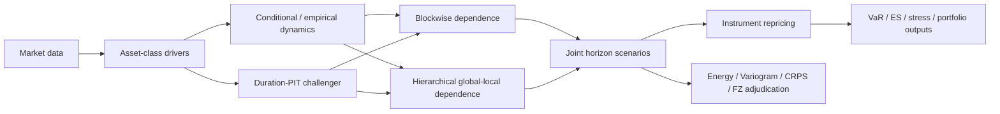

# Multi-Asset Scenario Engine

**Physical-measure multi-asset predictive distributions, cross-asset dependence, full horizon repricing, and empirically adjudicated scenario architecture.**

The engine models **US equities, Treasury rates, credit spreads and FX** and converts their joint risk-driver distribution into horizon scenarios for pricing, risk, stress and portfolio systems. The research program deliberately tests extra modelling layers rather than assuming they help.

> **Validated production stance (v0.33):** at the currently validated **1M / 21-business-day horizon**, use **`raw_duration|hierarchical|direct_H`**. Objective-specific routing and normal/stress regime switching were tested on untouched holdouts and were **not promoted to production**.

## Research architecture
The controlled candidate family is `{raw duration, duration-PIT} × {blockwise, hierarchical} × {direct-H, recursive-1W}`. The framework separates marginal/conditional dynamics, empirical duration representation, cross-asset dependence, horizon propagation, full repricing and proper-score adjudication.



## Asset blocks
**Equities** — factor/statistical structures, compressed residual risk and conditional-volatility FHS.  
**Rates** — Treasury key-rate curve modelling, PCA/curve factors and full-curve bond repricing.  
**Credit** — spread factors, long-history Moody's stress backbone, horizon-consistent spread treatment, migration/default and corporate-bond repricing.  
**FX** — historical spot dynamics, cross-asset scenarios and FX-forward repricing.

## Cross-asset dependence
Blockwise empirical dependence remains the hard benchmark. The structured architecture uses a low-dimensional global span plus block-local residual risk targeting cross-block covariance directly.


The final monthly production policy retains **hierarchical** dependence, without claiming universal hierarchical dominance across all horizons or tasks.

## Final monthly adjudication
### V32.2 — objective specialization
Five objectives were tested: joint distribution (Energy Score), dependence (Variogram Score), marginals (CRPS), economic projections (projection CRPS), and a reference tail loss (FZ0 VaR/ES score). Specialists chosen on calibration did not produce broad robust gains versus one universal ex-ante engine on the untouched 2021–2026 holdout.

### V33 — regime conditioning
A transparent normal/stress state used equity vol, rates vol, lower-quality credit stress and dependence instability with hysteresis. No objective passed the pre-specified deployment gate versus both fixed-objective and universal baselines.

**Result:** model-selection complexity is a negative result, not a production feature. See `notebooks/05_monthly_model_adjudication.ipynb` and `docs/model_adjudication.md`.

## Validated production API
```python
from multi_asset_scenario_engine import validated_policy, model_for
policy = validated_policy()
assert policy.horizon == "1M"
assert model_for("joint_distribution") == "raw_duration|hierarchical|direct_H"
```

Driver contract:

| Driver | 1M scenario meaning |
|---|---|
| `EQ_EW` | aggregate equity log return |
| `RATE_DGS2` | 2Y Treasury yield change |
| `RATE_DGS10` | 10Y Treasury yield change |
| `RATE_DGS30` | 30Y Treasury yield change |
| `CREDIT_Aaa_spr` | Aaa-minus-DGS10 spread change |
| `CREDIT_Baa_spr` | Baa-minus-DGS10 spread change |
| `FX_EURUSD` | EURUSD log return |

Portfolio consumers should preferably receive the **repriced instrument/asset-return scenario matrix**, not raw drivers. See `docs/consumer_interface.md`.

## Risk-engine continuity
The model-adjudication research sits on the earlier multi-horizon scenario/repricing backbone. Reference v23 95% VaR validation remains in `results/v23_var_es_reference.csv`.


## Repository structure
```text
multi-asset-scenario-engine/
├── README.md
├── docs/
│   ├── consumer_interface.md
│   ├── model_adjudication.md
│   └── research_decisions.md
├── figures/
├── results/
│   ├── v32_specialization_vs_universal_holdout.csv
│   ├── v33_regime_holdout.csv
│   ├── v33_regime_verdict.csv
│   └── v33_production_manifest.json
├── notebooks/
│   ├── 01_engine_standalone.ipynb
│   ├── 02_dependence_architecture_ablation.ipynb
│   ├── 03_duration_pit_factorial.ipynb
│   ├── 04_validation_scores.ipynb
│   └── 05_monthly_model_adjudication.ipynb
├── src/multi_asset_scenario_engine/
│   ├── production.py
│   ├── dependence.py
│   ├── duration.py
│   ├── scoring.py
│   ├── simulation.py
│   ├── repricing.py
│   └── ...
└── tests/
```

## Quick start
```bash
python -m venv .venv
source .venv/bin/activate          # Windows: .venv\Scripts\activate
pip install -e .
pytest -q
jupyter lab notebooks/01_engine_standalone.ipynb
```

Final adjudication sample begins after the DGS30 discontinuity and is frozen through **2026-05-01**. Live consumers should refit the **same validated architecture** to the target as-of date rather than re-selecting architecture downstream.
